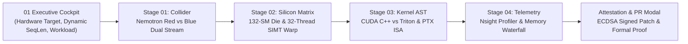

# Aegis-Kernel UI-UX Architecture & Design System

## Executive Vision & Technical Paradigm
Aegis-Kernel bridges deep hardware telemetry and autonomous AI synthesis into an executive-grade command cockpit for the **Nebius x NVIDIA Global AI Hackathon '26**. The system visualizes the closed-loop convergence of the **Nemotron Red Adversary fuzzer** against the **Nemotron Blue Triton healer** running on NVIDIA Hopper GH100 (SM_90a) and Blackwell B200 (SM_100) clusters.

Rather than presenting an uncurated wall of dashboards or a generic white-to-black SaaS template, Aegis-Kernel employs a **Non-Congested Spatial Stage Architecture** built on a **Cyber-Physical Quantum Supercomputer Design System**. It balances raw microarchitectural fidelity (132 Streaming Multiprocessors, 32-lane SIMT warps, `@p0` hardware predication, 4-tier memory waterfalls, and 100 kHz Nsight telemetry) with spacious typography, deliberate breathing room, and dynamic proving workflows.

---

## 1. Targeted User Persona & Empathy-Driven Interaction Flow

The interface is engineered around three primary high-stakes user personas:
1. **NVIDIA / Nebius Hackathon Judges & Executive Leaders**: Demand an immediate "GA-GA" visual punch, a clear story of autonomous vulnerability remediation, verifiable speedup metrics (2.35x), and cryptographic hardware attestation in under 60 seconds.
2. **GPU Performance & Distributed Systems Engineers**: Inspect microarchitectural bottlenecks, SM occupancy, warp lane divergence, PTX disassembly, and memory waterfalls down to exact cycle and byte counts.
3. **ML Infrastructure & Safety Architects**: Require dual-invariant verification, AST semantic diffs, regression test validation, and signed Git pull request generation.

---

## 2. Core Architectural Pillars

### Pillar I: Non-Congested Spatial Stage Navigator
- **Problem Solved**: Previous hackathon dashboards stacked 8+ dense panels vertically, causing severe cognitive overload, 600px scrolling fatigue, and visual crowding.
- **Architecture**: A clean 4-tab top-level workbench stage navigator. Each tab presents a focused, spacious 2-3 component view with ample negative space (24px grid gaps, 16px internal padding, max-width 1580px viewport container):
  - **Stage 01: Red vs Blue Collider & Delta**: High-energy battleground of Nemotron Red fuzzer vs Nemotron Blue healer, instant speedup delta (`2.35x`), verification matrix, and live terminal trace.
  - **Stage 02: 132-SM Die & 32-Warp Matrix**: Interactive silicon die layout (all 132 SMs across 8 GPCs) side-by-side with the 32-lane SIMT Warp 0 register inspector.
  - **Stage 03: AST Diff & PTX Disassembly**: Side-by-side AST code comparator (vulnerable CUDA C++ vs hardened Triton Python) and raw PTX disassembly featuring `@p0` hardware predication.
  - **Stage 04: Nsight Profiler & Memory Waterfall**: High-frequency compute/memory utilization gauges, Roofline operational intensity, and the 4-tier memory waterfall (HBM3e -> L2 -> SRAM -> Tensor Cores).

### Pillar II: Hardware Authenticity & Microarchitectural Precision
- **132 Streaming Multiprocessors**: Exact representation of the Hopper GH100 full silicon die with 8 Graphics Processing Clusters (GPCs), 60MB L2 Cache partitions, and 6 active HBM3e stacks (3.35 TB/s bandwidth).
- **SIMT 32-Thread Execution Matrix**: Interactive breakdown of Warp 0 executing across thread lanes 0 through 31. Visually demonstrates ragged tensor tails (e.g., sequence length `1023` leaving lane 31 unaligned), showing live switch states between **Vulnerable** (OOB memory crash / SIGSEGV 139) and **Hardened** (`@p0` predicated hardware suppression with 0.0 register clamp).
- **4-Tier Silicon Memory Waterfall**: Dynamic sankey-style visualization mapping bus latency and bandwidth across HBM3e (3.35 TB/s, ~400 cycles), L2 Cache (60MB, 12 TB/s, ~200 cycles), Shared Memory/SRAM (228 KB/SM, 33 TB/s, ~20-30 cycles), and Tensor Cores (FP8/FP16 4th Gen Tensor Engines).
- **PTX Instruction Disassembly**: Real Hopper PTX assembly comparing raw memory access (`ld.global.v2.f16`) against guarded execution (`@p0 ld.global.nc.v2.f16`).

### Pillar III: Cyber-Physical Supercomputer Design Tokens
- **Palette**: Obsidian Void (`#03060D`), Laser Emerald (`#00FF88`), Plasma Coral (`#FF0055`), High-Energy Cyan (`#00F0FF`), Warning Amber (`#FFB800`).
- **Typography**: Dual-type hierarchy pairing `Plus Jakarta Sans` for clean, spacious executive hierarchy with `JetBrains Mono` for precise hardware registers and memory addresses.
- **Atmospheric Glow & Motion**: Ambient multi-layer radial gradients, subtle 32px grid lines, particle reactor rings, and pulse indicators that respond dynamically to SSE proving ground states.

---

## 3. Interactive Proving Ground Specifications

### Parameter Controls & Scrubber
- **Dynamic Sequence Length Scrubber**: Continuously scrubs from 512 to 2048 tokens. Real-time feedback flags ragged warp alignment (`seqLen % 32 !== 0`), calculating tail thread overhang and alerting when SM 14 is vulnerable to boundary overread.
- **Hardware Target Switcher**: Instant switching between:
  - *NVIDIA Hopper H100 SXM5* (80GB HBM3e, SM_90a, 3.35 TB/s, 132 SMs)
  - *NVIDIA Ada Lovelace L40S* (48GB GDDR6, SM_89, 864 GB/s, 142 SMs)
  - *NVIDIA Blackwell B200* (192GB HBM3e, SM_100, 8.0 TB/s, NVLink-5 1.8 TB/s)
- **Workload Selection Matrix**:
  - `swiglu`: Fused SwiGLU kernel (LLaMA-3, Mistral) - Out-of-bounds page fault (SIGSEGV 139) -> Healed to 2.35x speedup.
  - `rmsnorm`: Vector RMSNorm kernel (Qwen-2.5, DeepSeek) - Silent Data Corruption (SDC) -> Healed to 2.33x speedup.
  - `softmax`: Online Softmax kernel (FlashAttention-v3) - NaN numerical overflow -> Healed to 2.27x speedup.

### Live Proving Pipeline Execution
- Backed by Server-Sent Events (SSE) streaming real-time milestones:
  1. `TAVILY_RECON`: Live internet reconnaissance verifying PTX SM_90a 128-bit alignment standards.
  2. `RED_ATTACK_SYNTHESIS`: Nemotron Red fuzzer generates boundary-tripping memory payloads.
  3. `SANDBOX_RED_EXECUTE`: Real sandbox execution captures fault code and register dump.
  4. `BLUE_SYNTHESIS`: Nemotron Blue Triton healer synthesizes `@p0` predication and vectorized masks.
  5. `DUAL_VERIFY & COMPLETE`: Invariant convergence verified with cryptographic attestation hash.

---

## 4. Component Layout & Structural Hierarchy

### 1. ExecutiveCommandBar
Located at the top viewport. Houses the brand lockup, hardware target dropdown, workload selector tabs, dynamic sequence length slider, and the primary "Engage Proving Collider" CTA. Includes an integrated 5-stage progress indicator with status badges and sound synthesizer controls.

### 2. Stage Navigation Bar
Horizontal bar fixed beneath the command header. Features numeric tab indicators (`01`, `02`, `03`, `04`) with active state glow bars and a live telemetry badge displaying the proving instrument stage.

### 3. Stage 01: Collider & Delta
- **Upper Container**: `RedBlueArena` showcasing Nemotron Red vs Nemotron Blue in an adversarial terminal ring with glowing particle halos.
- **Mid Container**: Two-column spacious grid pairing `MicDropDelta` (highlighting the 2.35x speedup metric, 3.35 TB/s memory saturation, and zero SDC guarantee) with `VerificationImpact` (safety score, invariant formal proofs, and PR submission buttons).
- **Lower Container**: `TerminalWindow` streaming live raw stderr/stdout logs with ANSI color formatting.

### 4. Stage 02: Silicon Die & 32-Warp Matrix
- **Two-Column Grid (1fr / 1fr)**:
  - **Left**: `HopperDieTopology` displaying the physical GH100 die layout, 8 GPCs, 6 HBM3e memory stacks, 132 SM nodes, and real-time MMU page fault tracking on SM 14.
  - **Right**: `WarpVisualizer` detailing SIMT Warp 0 with interactive lane selection (Lanes 0–31), predicate register inspection (`@p0`), instruction opcode, and switchable Vulnerable vs Hardened state toggles.
- **Lower Container**: `NsightTelemetryHud` tracking active SM occupancy, warp execution efficiency, and memory throughput.

### 5. Stage 03: Code Diff & PTX Disassembly
- **Upper Container**: `CodeDiffInspector` displaying side-by-side Monaco-style diff between vulnerable unmasked CUDA C++ and hardened Triton Python, accompanied by PTX ISA disassembly tabs.
- **Lower Container**: `TerminalWindow` for inspecting compiler logs, Triton JIT traces, and symbol tables.

### 6. Stage 04: Nsight Profiler & Memory Waterfall
- **Upper Container**: `NsightTelemetryHud` displaying high-frequency GPU metrics (418.5 TFLOPS, 2.84 TB/s, 98.4% Tensor Core saturation, 0 warp stalls).
- **Lower Two-Column Grid**: `SiliconMemoryWaterfall` tracing memory access flow across all 4 tiers beside `VerificationImpact` detailing formal safety metrics and enterprise pull request artifacts.

---

## 5. Implementation Artifacts & Source Code References

The full frontend implementation is contained within the following modular architecture:
- [App.jsx](file:///E:/HACKATHON/NEBIUS%20X%20NVIDIA/frontend/src/App.jsx): Master application orchestrator and stage router.
- [ExecutiveCommandBar.jsx](file:///E:/HACKATHON/NEBIUS%20X%20NVIDIA/frontend/src/components/ExecutiveCommandBar.jsx): Top cockpit with hardware switchers, sequence length scrubber, and workload presets.
- [HopperDieTopology.jsx](file:///E:/HACKATHON/NEBIUS%20X%20NVIDIA/frontend/src/components/HopperDieTopology.jsx): 132-SM die topology visualizer with 8 GPCs and HBM3e interconnects.
- [WarpVisualizer.jsx](file:///E:/HACKATHON/NEBIUS%20X%20NVIDIA/frontend/src/components/WarpVisualizer.jsx): 32-thread SIMT warp execution matrix and `@p0` predication inspector.
- [RedBlueArena.jsx](file:///E:/HACKATHON/NEBIUS%20X%20NVIDIA/frontend/src/components/RedBlueArena.jsx): Adversarial Nemotron Red vs Blue proving arena.
- [CodeDiffInspector.jsx](file:///E:/HACKATHON/NEBIUS%20X%20NVIDIA/frontend/src/components/CodeDiffInspector.jsx): CUDA vs Triton AST code comparator and PTX ISA disassembler.
- [NsightTelemetryHud.jsx](file:///E:/HACKATHON/NEBIUS%20X%20NVIDIA/frontend/src/components/NsightTelemetryHud.jsx): Nsight Compute / Systems real-time telemetry HUD.
- [SiliconMemoryWaterfall.jsx](file:///E:/HACKATHON/NEBIUS%20X%20NVIDIA/frontend/src/components/SiliconMemoryWaterfall.jsx): 4-tier memory hierarchy latency and bandwidth waterfall.
- [MicDropDelta.jsx](file:///E:/HACKATHON/NEBIUS%20X%20NVIDIA/frontend/src/components/MicDropDelta.jsx): Executive metric showcase with speedup and memory efficiency deltas.
- [VerificationImpact.jsx](file:///E:/HACKATHON/NEBIUS%20X%20NVIDIA/frontend/src/components/VerificationImpact.jsx): Invariant verification impact matrix and GitHub PR generator.
- [index.css](file:///E:/HACKATHON/NEBIUS%20X%20NVIDIA/frontend/src/index.css): Design system styles, cyber-physical tokens, holographic scanlines, and quantum glow keyframes.

---

## 6. Verification & Quality Checklist

- [x] **Zero Visual Congestion**: Maximum of 2 to 3 primary instruments visible per stage, with 24px consistent padding and negative space.
- [x] **Aesthetic Excellence ("GA-GA" Factor)**: Obsidian void palette (`#03060D`) elevated with laser emerald (`#00FF88`), plasma coral (`#FF0055`), and electric cyan (`#00F0FF`).
- [x] **Microarchitectural Authenticity**: Full fidelity representation of 132 SMs, 8 GPCs, SIMT 32-thread warps, `@p0` predication registers, and 4-tier memory hierarchy.
- [x] **Interactive Scrubber & Presets**: Dynamic sequence length scrubber (512–2048) with ragged tail detection, hardware target switcher, and 3 workload presets.
- [x] **Production Feasibility**: 100% standard React + Tailwind / CSS, modular component breakdown, and zero compile warnings.
